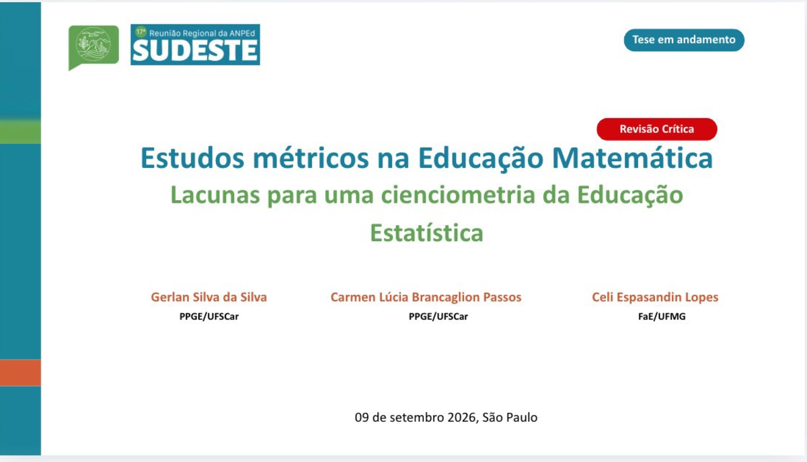

<a href="https://canva.link/cgqkftbk7z4vb47" class="btn-slides" target="_blank" rel="noopener"><i class="bi bi-easel2" aria-hidden="true"></i> Abrir apresentação</a>

Apresentação hospedada no Canva. Abre em nova aba.

## Sobre a apresentação

Apresentação na 17ª Reunião Regional da ANPEd Sudeste, em São Paulo, no formato de revisão crítica de tese em andamento, com orientação de Carmen Lúcia Brancaglion Passos e coorientação de Celi Espasandin Lopes.

O trabalho discute as lacunas dos estudos métricos na Educação Matemática e propõe uma cienciometria da Educação Estatística: extração de metadados via API do OpenAlex, padronização em planilha e construção de redes de coautoria, cocitação e coocorrência no VOSviewer.

- **Campo:** Educação Estatística no Brasil e na Espanha.
- **Método:** estudo cienciométrico com apoio de Python, OpenAlex e VOSviewer.
- **Complemento:** entrevistas narrativas com pesquisadoras do campo.
