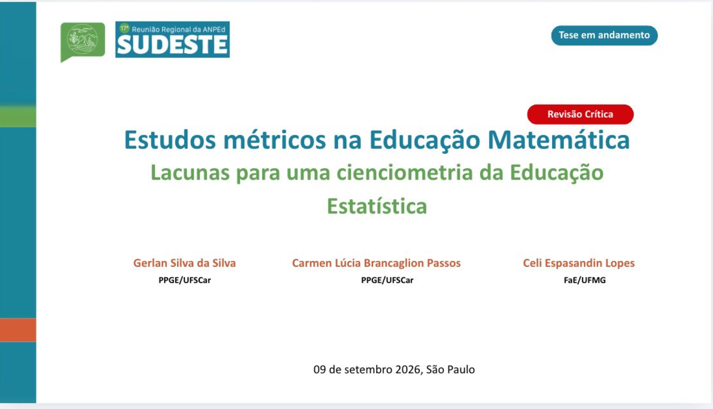

<a href="https://canva.link/cgqkftbk7z4vb47" class="btn-slides" target="_blank" rel="noopener"><i class="bi bi-easel2" aria-hidden="true"></i> Open presentation</a>

Presentation hosted on Canva. Opens in a new tab.

## About the presentation

Presentation at the 17th Regional Meeting of ANPEd Southeast, in São Paulo, in the format of a critical review of an ongoing dissertation, under the supervision of Carmen Lúcia Brancaglion Passos and with the co-supervision of Celi Espasandin Lopes.

The paper discusses the gaps of metric studies in Mathematics Education and proposes a scientometrics of Statistical Education: extraction of metadata via the OpenAlex API, standardization in a spreadsheet and construction of co-authorship, co-citation and co-occurrence networks in VOSviewer.

- **Field:** Statistical Education in Brazil and Spain.
- **Method:** scientometric study supported by Python, OpenAlex and VOSviewer.
- **Complement:** narrative interviews with researchers in the field.
