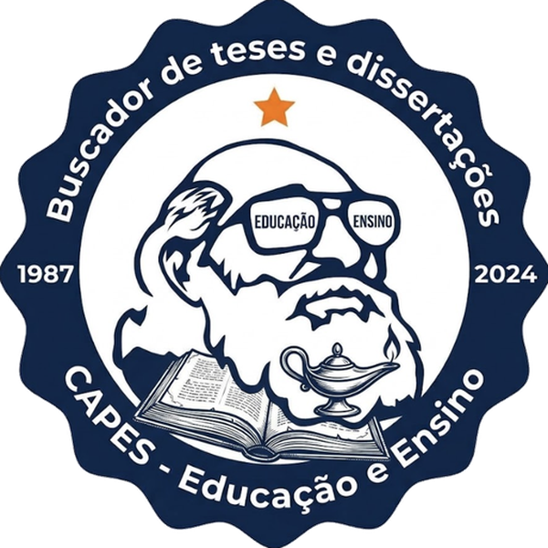

::: {.proj-intro}

CaPesquisa brings Brazilian theses and dissertations from the **Education** and **Teaching** evaluation areas into a single search. It covers **109,183 works defended between 1987 and 2024**, from **663 institutions**, queried in real time through the public API of the CAPES Graduate Studies Observatory.

:::

## What it is

It is an independent search engine published at `capesquisa.pages.dev`. The page is static — HTML, CSS and JavaScript, with no build step — and queries the CAPES API directly, which allows CORS access. The project is not official to CAPES or UFSCar: it gathers and organizes public data, pointing to the original record of each work.

## How to search

The text search accepts a few words and can be restricted to the **title**, the **abstract** or both. The **exact term** option (or quotation marks) looks for the whole phrase, and the search is case-insensitive and does not require accents.

Next to the results, the filter bar allows refining by **evaluation area** (Education, Teaching or both), **defense year**, **degree** (academic master's, doctorate, professional master's and doctorate), **state**, **region**, **administrative dependency** and **institution**.

Each card shows title, degree, year, institution acronym, state, authorship, concentration area and the first lines of the abstract. The title and the "Open in the CAPES catalogue" button lead to the official record, where the full abstract is available. The search state lives in the URL, so a set of results can be shared or saved.

## Main features

- **Combined search and filters**, with pagination and keyboard navigation;
- **Details dialog** with the full abstract, advisor, committee, program, keywords and a ready-to-copy citation;
- **CSV export** of the results (up to 300 rows);
- **PDF button**, which resolves the attachment in the old CAPES record through a separate service;
- **Shareable address**, with all query parameters;
- **Responsive layout**, with collapsible filters on mobile.

## Data and limits

Metadata is provided by the graduate programs themselves to CAPES, and the database is updated by the institution. The PDF attachment only exists when disclosure has been authorized in the old record; otherwise the button leads to the CAPES page. In text searches, the catalogue does not report the exact number of results — that is why page navigation appears without that number.

## Access

- **Website** — [capesquisa.pages.dev](https://capesquisa.pages.dev/)
- **Source code** (MIT license) — [github.com/gerlansilva/capes_eduensino](https://github.com/gerlansilva/capes_eduensino)
- **Official CAPES catalogue** — [catalogodeteses.capes.gov.br](https://catalogodeteses.capes.gov.br/)
