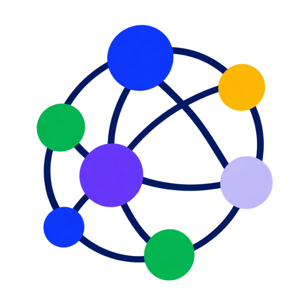

::: {.proj-intro}



Redes turns the file exported from a bibliographic database into maps of academic production: themes that appear together, authors who cite one another, institutions that collaborate and how all of this changes from one period to another. The interface runs on the researcher's machine, in Portuguese, and no data is sent outside.

:::

## What it is

It is a tool for scientific mapping and network analysis, with a local web interface and a command line. The starting point is the file the person already has — the export from Scopus, Web of Science, OpenAlex, Zotero, or a BibTeX, RIS or CSV — and not a database of its own. The current version is **0.2.0**, distributed under the **GPL-3.0-or-later** license.

## How it works

The path has three steps. First, choose the file and, if desired, enter the periods, for example `2010-2015, 2016-2020`; the format is recognized by the content, not by the extension. Then, mark which analyses to build. Finally, explore the results in the interface or export them.

Each analysis answers a question: **what is written** (keyword co-occurrence), **on whom one relies** (co-citation and bibliographic coupling), **with whom one writes** (co-authorship and affiliations) and **how this changes over time** (thematic evolution and overlap of themes between periods). The networks are built with NetworkX and the clusters follow the Louvain algorithm.

## Main features

- **Input** in Scopus, Web of Science, OpenAlex, Zotero, BibTeX, RIS and tabulated CSV;
- **Themes**, with keyword co-occurrence and groups by period;
- **Authors, references, research fronts and journals**, by co-citation and bibliographic coupling;
- **Co-authorship, countries and institutions**, from the affiliations;
- **Thematic evolution**, strategic diagram (centrality and density) and network in halos;
- **Descriptive overview**: production, citations, Lotka, Bradford and Zipf laws, bursts and h, g and other indexes;
- **Timeline** and complete report in HTML, as a single file or folder;
- **Export** in TSV, SVG, PNG, CSV, GraphML, Pajek (`.net`) and group XML.

## Responsible reading

The tool does not block analyses: when a period has fewer than 20 documents, when more than half of the themes have a single document, when a term appears in 35% or more of the corpus, among other situations, the result receives the **Quality** seal and the report records the caveat alongside the analysis. A warning means "read as an indication", not as a conclusion.

## Requirements and installation

There is an installer for **macOS** (`.dmg`, Apple Silicon) and **Windows** (10/11, 64-bit), which opens the same interface in its own window, with the embedded server. To use the command line, Python 3.10 or newer is required:

```bash
python3 -m venv ~/venv_redes
source ~/venv_redes/bin/activate
pip install git+https://github.com/gerlansilva/redes
redes web
```

## Access to the tool

- **Source code and installers** — [github.com/gerlansilva/redes](https://github.com/gerlansilva/redes)
- **User guide and documentation** — [docs/guia-de-uso.md](https://github.com/gerlansilva/redes/blob/main/docs/guia-de-uso.md)
