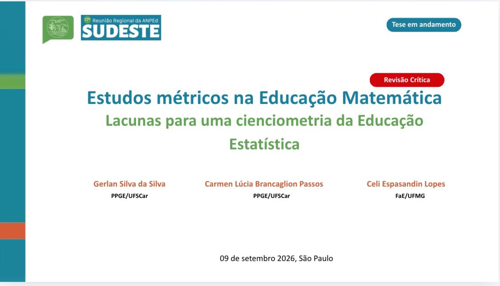

<a href="https://canva.link/cgqkftbk7z4vb47" class="btn-slides" target="_blank" rel="noopener"><i class="bi bi-easel2" aria-hidden="true"></i> Abrir presentación</a>

Presentación alojada en Canva. Se abre en una nueva pestaña.

## Sobre la presentación

Presentación en la 17ª Reunión Regional de la ANPEd Sudeste, en São Paulo, en el formato de revisión crítica de tesis en curso, con dirección de Carmen Lúcia Brancaglion Passos y codirección de Celi Espasandin Lopes.

El trabajo discute los vacíos de los estudios métricos en la Educación Matemática y propone una cienciometría de la Educación Estadística: extracción de metadatos vía API de OpenAlex, estandarización en planilla y construcción de redes de coautoría, cocitación y coocurrencia en VOSviewer.

- **Campo:** Educación Estadística en Brasil y en España.
- **Método:** estudio cienciométrico con apoyo de Python, OpenAlex y VOSviewer.
- **Complemento:** entrevistas narrativas con investigadoras del campo.
