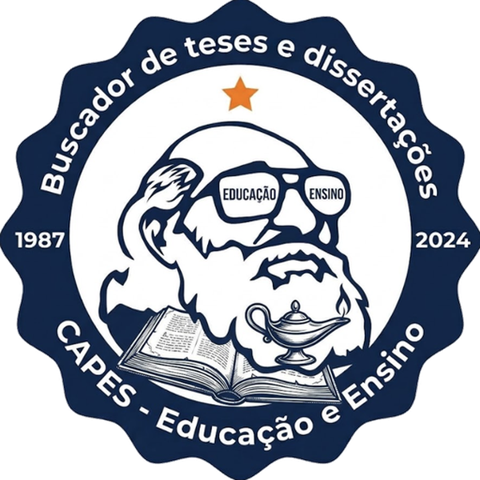

::: {.proj-intro}

CaPesquisa reúne las tesis y disertaciones brasileñas de las áreas de evaluación **Educación** y **Enseñanza** en una única búsqueda. Son **109.183 trabajos defendidos entre 1987 y 2024**, de **663 instituciones**, consultados en tiempo real en la API pública del Observatorio de Posgrado de la CAPES.

:::

## Qué es

Es un buscador independiente, publicado en `capesquisa.pages.dev`. La página es estática —HTML, CSS y JavaScript, sin etapa de compilación— y consulta directamente la API de la CAPES, que permite acceso por CORS. El proyecto no es oficial de la CAPES ni de la UFSCar: reúne y organiza datos públicos, indicando el registro de origen de cada trabajo.

## Cómo buscar

La búsqueda textual acepta pocas palabras y puede restringirse al **título**, al **resumen** o a ambos. La opción de **término exacto** (o el uso de comillas) busca la frase completa, y la búsqueda no distingue mayúsculas de minúsculas ni exige acentos.

Junto a los resultados, la barra de filtros permite refinar por **área de evaluación** (Educación, Enseñanza o ambas), **año de defensa**, **grado** (maestría, doctorado, maestría y doctorado profesionales), **estado**, **región**, **dependencia administrativa** e **institución**.

Cada tarjeta muestra título, grado, año, sigla de la institución, estado, autoría, área de concentración y las primeras líneas del resumen. El título y el botón "Abrir en el catálogo de la CAPES" llevan al registro oficial, donde está la versión completa del resumen. El estado de la búsqueda queda en la URL, lo que permite compartir o guardar un conjunto de resultados.

## Funciones principales

- **Búsqueda y filtros combinados**, con paginación y navegación por teclado;
- **Diálogo de detalles** con resumen completo, orientación, tribunal, programa, palabras clave y cita lista para copiar;
- **Exportación en CSV** de los resultados (hasta 300 filas);
- **Botón PDF**, que resuelve el anexo en el registro antiguo de la CAPES mediante un servicio aparte;
- **Dirección compartible**, con todos los parámetros de la consulta;
- **Diseño adaptable**, con filtros plegables en el celular.

## Datos y límites

Los metadatos son informados por los propios programas de posgrado a la CAPES, y la base es actualizada por la institución. El anexo en PDF solo existe cuando hay autorización de divulgación en el registro antiguo; sin ella, el botón lleva a la página de la CAPES. En búsquedas textuales, el catálogo no informa el total exacto de resultados —por eso la navegación por páginas aparece sin ese número.

## Acceso

- **Sitio** — [capesquisa.pages.dev](https://capesquisa.pages.dev/)
- **Código fuente** (licencia MIT) — [github.com/gerlansilva/capes_eduensino](https://github.com/gerlansilva/capes_eduensino)
- **Catálogo oficial de la CAPES** — [catalogodeteses.capes.gov.br](https://catalogodeteses.capes.gov.br/)
