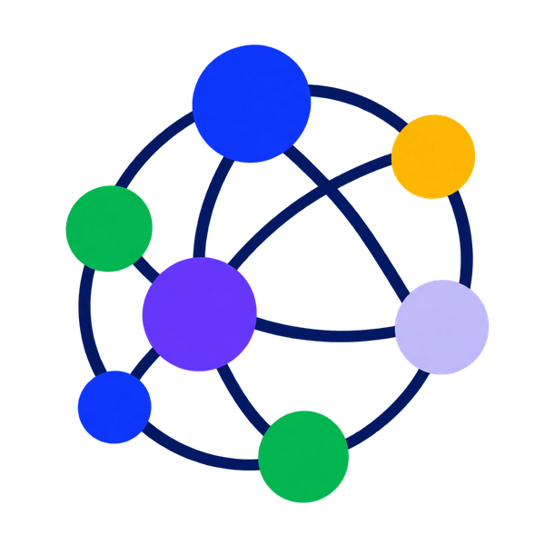

::: {.proj-intro}



Redes transforma el archivo exportado de una base bibliográfica en mapas de la producción académica: temas que aparecen juntos, autores que se citan, instituciones que colaboran y cómo todo eso cambia de un período a otro. La interfaz se ejecuta en la máquina del investigador, en portugués, y ningún dato se envía fuera.

:::

## Qué es

Es una herramienta de mapeo científico y análisis de redes, con interfaz web local y línea de comandos. El punto de partida es el archivo que la persona ya tiene —la exportación de Scopus, de Web of Science, de OpenAlex, de Zotero, o un BibTeX, RIS o CSV— y no una base propia. La versión actual es la **0.2.0**, distribuida bajo licencia **GPL-3.0-or-later**.

## Cómo funciona

El recorrido tiene tres pasos. Primero, elegir el archivo y, si se quiere, indicar los períodos, por ejemplo `2010-2015, 2016-2020`; el formato se reconoce por el contenido, no por la extensión. Después, marcar qué análisis construir. Por último, explorar los resultados en la interfaz o exportarlos.

Cada análisis responde a una pregunta: **qué se escribe** (coocurrencia de palabras clave), **en quién se apoya** (cocitación y acoplamiento bibliográfico), **con quién se escribe** (coautoría y afiliaciones) y **cómo cambia eso en el tiempo** (evolución temática y superposición de temas entre períodos). Las redes se construyen con NetworkX y los agrupamientos siguen el algoritmo de Louvain.

## Recursos principales

- **Entrada** en Scopus, Web of Science, OpenAlex, Zotero, BibTeX, RIS y CSV tabulado;
- **Temas**, con coocurrencia de palabras clave y grupos por período;
- **Autores, referencias, frentes y revistas**, por cocitación y acoplamiento bibliográfico;
- **Coautoría, países e instituciones**, a partir de las afiliaciones;
- **Evolución temática**, diagrama estratégico (centralidad y densidad) y red en halos;
- **Visión general descriptiva**: producción, citas, leyes de Lotka, Bradford y Zipf, ráfagas e índices h, g y otros;
- **Línea de tiempo** e informe completo en HTML, en archivo único o carpeta;
- **Exportación** en TSV, SVG, PNG, CSV, GraphML, Pajek (`.net`) y XML de grupos.

## Lectura responsable

La herramienta no bloquea análisis: cuando un período tiene menos de 20 documentos, cuando más de la mitad de los temas tiene un solo documento, cuando un término aparece en el 35% o más del corpus, entre otras situaciones, el resultado recibe el sello de **Calidad** y el informe registra la salvedad junto al análisis. Una advertencia significa «leer como indicio», no como conclusión.

## Requisitos e instalación

Hay instalador para **macOS** (`.dmg`, Apple Silicon) y **Windows** (10/11, 64 bits), que abre la misma interfaz en una ventana propia, con el servidor incorporado. Para usar la línea de comandos, se requiere Python 3.10 o superior:

```bash
python3 -m venv ~/venv_redes
source ~/venv_redes/bin/activate
pip install git+https://github.com/gerlansilva/redes
redes web
```

## Acceso a la herramienta

- **Código fuente e instaladores** — [github.com/gerlansilva/redes](https://github.com/gerlansilva/redes)
- **Guía de uso y documentación** — [docs/guia-de-uso.md](https://github.com/gerlansilva/redes/blob/main/docs/guia-de-uso.md)
