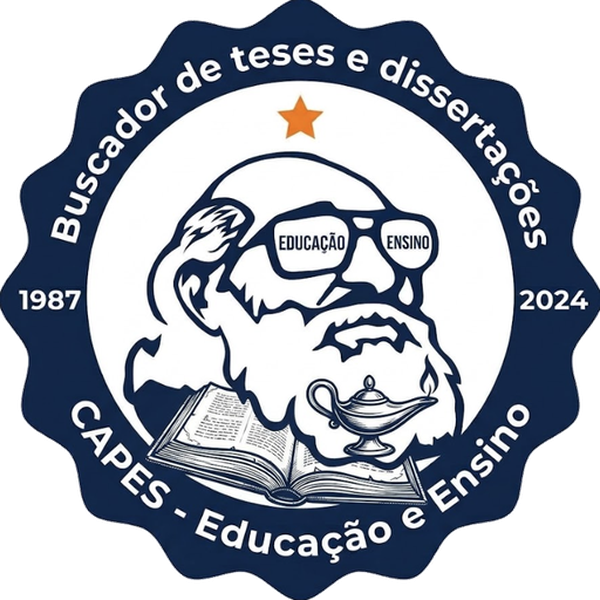

::: {.proj-intro}

O CaPesquisa reúne as teses e dissertações brasileiras das áreas de avaliação **Educação** e **Ensino** em uma única busca. São **109.183 trabalhos defendidos entre 1987 e 2024**, em **663 instituições**, consultados em tempo real na API pública do Observatório da Pós-Graduação da CAPES.

:::

## O que é

É um buscador independente, publicado em `capesquisa.pages.dev`. A página é estática — HTML, CSS e JavaScript, sem etapa de build — e faz a consulta diretamente à API da CAPES, que libera acesso por CORS. O projeto não é oficial da CAPES nem da UFSCar: reúne e organiza dados públicos, indicando o registro de origem de cada trabalho.

## Como buscar

A busca textual aceita poucas palavras e pode ser restrita ao **título**, ao **resumo** ou a ambos. A opção de **termo exato** (ou o uso de aspas) procura a frase inteira, e a busca não diferencia maiúsculas de minúsculas nem exige acentos.

Ao lado dos resultados, a barra de filtros permite refinar por **área de avaliação** (Educação, Ensino ou as duas), **ano de defesa**, **grau** (mestrado, doutorado, mestrado e doutorado profissionais), **UF**, **região**, **dependência administrativa** e **instituição**.

Cada cartão mostra título, grau, ano, sigla da instituição, UF, autoria, área de concentração e as primeiras linhas do resumo. O título e o botão "Abrir no catálogo da CAPES" levam ao registro oficial, onde está a versão integral do resumo. O estado da busca fica na URL, o que permite compartilhar ou guardar um conjunto de resultados.

## Recursos principais

- **Busca e filtros combinados**, com paginação e navegação por teclado;
- **Diálogo de detalhes** com resumo completo, orientação, banca, programa, palavras-chave e citação pronta para copiar;
- **Exportação em CSV** dos resultados (até 300 linhas);
- **Botão PDF**, que resolve o anexo no registro antigo da CAPES por um serviço à parte;
- **Endereço compartilhável**, com todos os parâmetros da consulta;
- **Layout responsivo**, com filtros recolhíveis no celular.

## Dados e limites

Os metadados são informados pelos próprios programas de pós-graduação à CAPES, e a base é atualizada pela instituição. O anexo em PDF só existe quando há autorização de divulgação no registro antigo; sem ela, o botão leva à página da CAPES. Em buscas textuais, o catálogo não informa o total exato de resultados — por isso a navegação por páginas aparece sem esse número.

## Acesso

- **Site** — [capesquisa.pages.dev](https://capesquisa.pages.dev/)
- **Código-fonte** (licença MIT) — [github.com/gerlansilva/capes_eduensino](https://github.com/gerlansilva/capes_eduensino)
- **Catálogo oficial da CAPES** — [catalogodeteses.capes.gov.br](https://catalogodeteses.capes.gov.br/)
