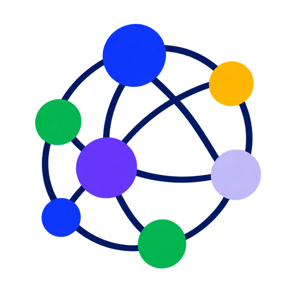

::: {.proj-intro}



O Redes transforma o arquivo exportado de uma base bibliográfica em mapas da produção acadêmica: temas que aparecem juntos, autores que se citam, instituições que colaboram e como tudo isso muda de um período para o outro. A interface roda na máquina do pesquisador, em português, e nenhum dado é enviado para fora.

:::

## O que é

É uma ferramenta de mapeamento científico e análise de redes, com interface web local e linha de comando. O ponto de partida é o arquivo que a pessoa já tem — a exportação do Scopus, da Web of Science, do OpenAlex, do Zotero, ou um BibTeX, RIS ou CSV — e não uma base própria. A versão atual é a **0.2.0**, distribuída sob licença **GPL-3.0-or-later**.

## Como funciona

O percurso tem três passos. Primeiro, escolher o arquivo e, se quiser, informar os períodos, por exemplo `2010-2015, 2016-2020`; o formato é reconhecido pelo conteúdo, não pela extensão. Depois, marcar quais análises construir. Por fim, explorar os resultados na interface ou exportá-los.

Cada análise responde a uma pergunta: **o que se escreve** (co-ocorrência de palavras-chave), **em quem se apoia** (cocitação e acoplamento bibliográfico), **com quem se escreve** (coautoria e afiliações) e **como isso muda no tempo** (evolução temática e sobreposição de temas entre períodos). As redes são construídas com NetworkX e os agrupamentos seguem o algoritmo de Louvain.

## Recursos principais

- **Entrada** em Scopus, Web of Science, OpenAlex, Zotero, BibTeX, RIS e CSV tabulado;
- **Temas**, com co-ocorrência de palavras-chave e grupos por período;
- **Autores, referências, frentes e periódicos**, por cocitação e acoplamento bibliográfico;
- **Coautoria, países e instituições**, a partir das afiliações;
- **Evolução temática**, diagrama estratégico (centralidade e densidade) e rede em halos;
- **Visão geral descritiva**: produção, citações, leis de Lotka, Bradford e Zipf, rajadas e índices h, g e outros;
- **Linha do tempo** e relatório completo em HTML, em arquivo único ou pasta;
- **Exportação** em TSV, SVG, PNG, CSV, GraphML, Pajek (`.net`) e XML de grupos.

## Leitura responsável

A ferramenta não bloqueia análises: quando um período tem menos de 20 documentos, quando mais da metade dos temas tem um só documento, quando um termo aparece em 35% ou mais do corpus, entre outras situações, o resultado recebe o selo de **Qualidade** e o relatório registra a ressalva junto da análise. Um aviso significa "leia como indício", não como conclusão.

## Requisitos e instalação

Há instalador para **macOS** (`.dmg`, Apple Silicon) e **Windows** (10/11, 64 bits), que abre a mesma interface em uma janela própria, com o servidor embutido. Para usar a linha de comando, é preciso Python 3.10 ou mais novo:

```bash
python3 -m venv ~/venv_redes
source ~/venv_redes/bin/activate
pip install git+https://github.com/gerlansilva/redes
redes web
```

## Acesso à ferramenta

- **Código-fonte e instaladores** — [github.com/gerlansilva/redes](https://github.com/gerlansilva/redes)
- **Guia de uso e documentação** — [docs/guia-de-uso.md](https://github.com/gerlansilva/redes/blob/main/docs/guia-de-uso.md)
