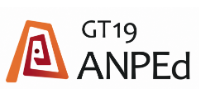
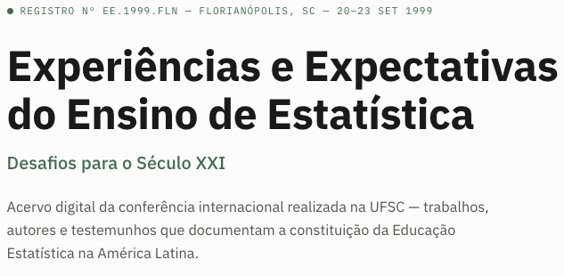
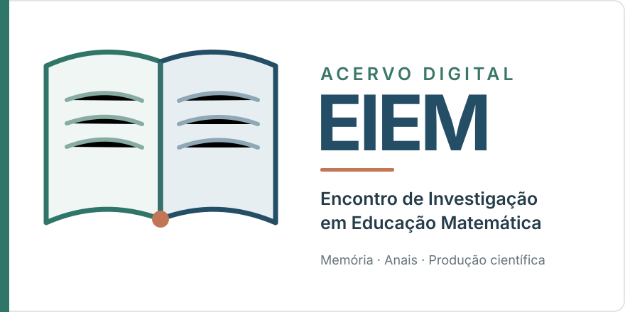

Ao consultar a produção científica de eventos, percebo como os anais, os trabalhos e outros registros podem se dispersar ou se tornar difíceis de encontrar com o passar dos anos. Muitas vezes, a disponibilização dos documentos termina junto com o evento, sem um trabalho continuado de organização, descrição, curadoria e preservação. Isso compromete não apenas o acesso aos textos, mas também a possibilidade de reconstruir a trajetória das discussões e das comunidades de pesquisa.

Foi dessa inquietação, associada ao meu interesse pela Ciência da Informação e pelos estudos métricos, que comecei a desenvolver, por iniciativa própria, acervos digitais voltados à memória científica. Não se trata de um único projeto nem de etapas da minha tese: cada iniciativa possui um objeto, um conjunto documental e desafios específicos. O propósito comum é tornar os registros mais acessíveis, contextualizados e menos vulneráveis ao esquecimento e à perda de referências.

::: {.project-grid}

::: {.project-card}

::: {.project-card-body}
### Memória do SIPEM

Desenvolvo o Memória do SIPEM diante da dificuldade de localizar e consultar, em um mesmo lugar, os registros das diferentes edições dos Seminários Internacionais de Pesquisa em Educação Matemática. A iniciativa reúne e organiza anais, trabalhos e informações sobre as edições, com atenção à recuperação dos documentos e à preservação da trajetória das pesquisas e dos debates do seminário.

[Explorar o acervo](https://gerlansilva.github.io/memoria-sipem/){.btn .btn-sm}
:::
:::

::: {.project-card}

::: {.project-card-body}
### Memória do GT 19

Acervo dedicado à continuidade do acesso aos trabalhos e registros do Grupo de Trabalho 19 — Educação Matemática, da ANPEd. O projeto identifica, organiza e dá visibilidade a esses registros, contribuindo para que pesquisadores possam consultar a produção do grupo em diferentes momentos e acompanhar suas discussões ao longo do tempo.

[Explorar o acervo](https://gt19anped.pages.dev/){.btn .btn-sm}
:::
:::

::: {.project-card}

::: {.project-card-body}
### Acervo da Primeira Conferência de Educação Estatística

Acervo dedicado à conferência *Experiências e Expectativas do Ensino de Estatística: Desafios para o Século XXI*, realizada em Florianópolis, em 1999. Reúne e contextualiza os registros localizados, evitando que documentos e informações sobre essa experiência permaneçam dispersos ou pouco conhecidos.

[Explorar o acervo](https://cieee-acervo.netlify.app/){.btn .btn-sm}
:::
:::

::: {.project-card}

::: {.project-card-body}
### Memória do EIEM

Acervo digital dedicado à memória do Encontro de Investigação em Educação Matemática (EIEM), realizado em Portugal. A iniciativa reúne e organiza registros das diferentes edições do encontro, em especial os trabalhos publicados nos anais, favorecendo a consulta à produção científica e a preservação da história das discussões do campo.

[Explorar o acervo](https://eiememoria.pages.dev/#sobre){.btn .btn-sm}
:::
:::

:::
